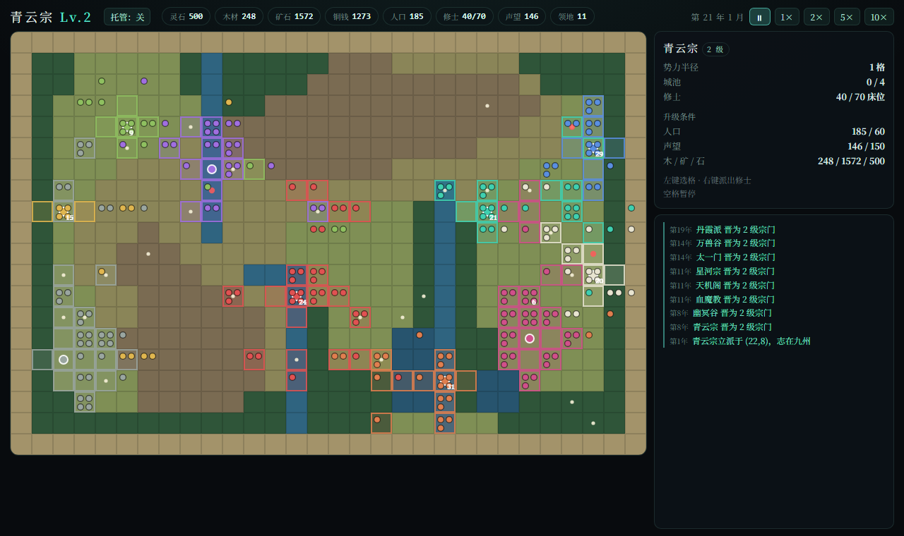

# 宗门争锋 · 基础可玩版 v0.1

> 十家宗门分据九州，占地、招人、建城、开战。
> 双击 `index.html` 即可游玩（纯前端，零依赖，无需服务器）。
>
> **接手开发请先读 [交接文档.md](交接文档.md)** —— 架构、坑、优先级都在里面。



---

## 操作

| 操作 | 说明 |
|---|---|
| **左键点自己的修士** | 选中该格（金色高亮 + 右侧显示队伍） |
| **再点任意格子** | 把这格里的修士全部派过去 |
| **右键点目标格** | 同上（派兵） |
| **再点一次已选中的格子** | 取消选择 |
| **空格** | 暂停 / 继续 |
| **Esc** | 取消选择 |
| 右上角 | 1× / 2× / 5× / 10× 调速 |
| **托管** | 开：AI 代管派遣；关：全手动 |

> 开局山门会**脉冲闪烁**，点它——右侧会列出三名修士，然后点任意目标格即可出兵。

**胜负**：占下 600 格中的 60%（360 格），或灭尽其他宗门。山门被夺光即输。

---

## 已实现

| 系统 | 状态 |
|---|---|
| 600 格地图（7 地形、河流、湖泊、村落） | ✅ |
| 十家宗门、山门选址、势力范围 | ✅ |
| 修士（灵根 / 体质 / 六属性 / 境界 / 寿元） | ✅ |
| 招募大会（每年 6 月，按床位收人） | ✅ |
| 派遣、寻路（Dijkstra，地形影响速度） | ✅ |
| 战斗（血量结算、溃退、战死抽签） | ✅ |
| 占领（走过即占）与一年腐坏 | ✅ |
| 建城（扩势力范围）、住房（扩床位） | ✅ |
| 宗门升级（人口 + 声望 + 材料） | ✅ |
| 资源：灵石 / 木材 / 矿石 / 铜钱 / 人口 | ✅ |
| AI：招募、派遣、建城、进攻 | ✅ |

## 未实现（设计有，但这版没做）

- 功法（20 本）、丹药、法宝
- 附庸、散修、新宗门刷新、灭门收编
- 城墙 / 攻城战
- 存档

---

## 与设计文档的偏差（为可玩性做的临时决定）

| 项 | 设计 | 本版 | 原因 |
|---|---|---|---|
| 一年时长 | 20 分钟 | **300 秒** | 20 分钟一年没法试玩 |
| 山门灵脉 | 灵石只产自山地 | 山门自带 **+30/年** | 否则没山的宗门永久卡在 1 级 |
| 开局 | 无保护 | **前 8 年 AI 不主动进攻** | 否则玩家挂机 6 年就被灭 |
| 住房 / 升级 | 手动 | **自动** | 减少操作量 |
| 战死名额 | `ceil(n × 率)` | **小数 + 概率进位** | `ceil` 会让小宗门每战必死一人，永远缓不过来 |

---

## 测试

```bash
cd slg
node test/sim.js 20261120 40   # 无界面跑 40 年（核心逻辑）
node test/dom.js               # DOM 桩，跑 600 帧渲染
```

`?skip=N` 可以直接快进 N 年（调试用，例：`index.html?skip=20`）。

---

## 已知问题

1. **修士数量与地图容量**：床位上限 160 × 10 家 = 1600 人，而地图 600 格。后期必然涂满，只能靠战争重分。
2. **灵石只进不出**：功法、法宝未做，灵石会一路堆到几万。
3. **AI 很朴素**：只挑「价值 ÷ 距离」最高的目标，不会集结、不会声东击西。
4. **没有存档**：刷新即重开。

---

## 文件

```
slg/
├── index.html        页面与样式
├── js/data.js        常量、地形、灵根、等级需求
├── js/world.js       地图生成、宗门、修士、年度结算
├── js/ai.js          寻路、招募、派遣、建城
├── js/sim.js         移动、战斗、事件
├── js/game.js        渲染、输入、面板、弹窗
├── test/sim.js       核心逻辑冒烟测试
├── test/dom.js       渲染循环桩测试
├── proto/            更早的无界面原型（AI 验证）
└── shots/            截图
```
